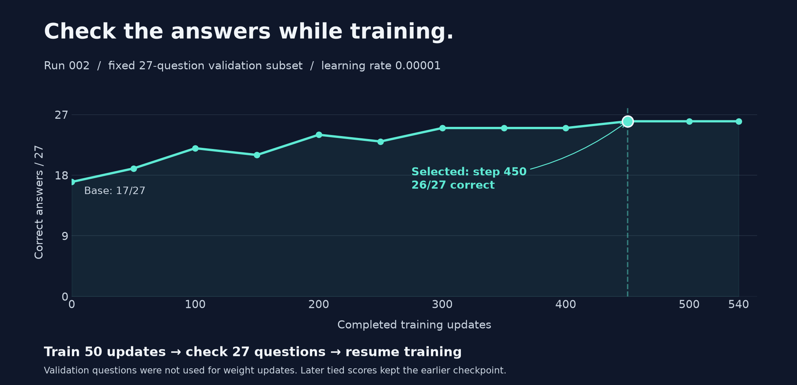

# A failed fine-tune, a smaller learning rate, a better model

**Dolphin 8B's classification accuracy fell from 70.71% to 54.21% after the first fine-tune—and reached 88.89% on the follow-up.** The second run used the same training data, a ten-times lower learning rate, and a checkpoint selected by evaluating generated answers during training.

The task: take a customer message such as “Where is my order?” and return `{"intent":"track_order"}`. There are **27 allowed intents**. A correct answer must choose the right label and follow the JSON format.

## 1. The first run looked good in the wrong metric

A separate QLoRA adapter was trained on **1,080 examples** while the base model's weights stayed frozen.

| Metric | Before | First adapter |
| --- | ---: | ---: |
| Correct classifications | 210/297 | **161/297** |
| Accuracy | 70.71% | **54.21%** |
| Validation token loss | 2.883 | 0.141 |
| Three general probes | Coherent | Repetitive |

Loss fell, but answers got worse. Token inspection showed why a low average loss could mislead: the model predicted repeated JSON syntax confidently while choosing the wrong intent. That explains the metric mismatch; it doesn't fully identify the cause of the regression.

## 2. First, check that it can learn at all

A fresh diagnostic adapter trained on **27 reviewed training examples, one per intent**, at learning rate `0.00001` and batch size 1.

**23/27 before → 26/27 at step 50 → 27/27 at step 100.** At that point the diagnostic stopped. The general probes remained coherent.

This measured memorization of the training examples rather than accuracy on unseen messages. The diagnostic adapter was kept separate; the full experiment started with another fresh adapter on the unchanged base model.

## 3. Full dataset, smaller updates, frequent checks

The **learning rate was the only training hyperparameter changed** in the full run. Monitoring and checkpoint selection also changed:

| Setting | Run 001 | Run 002 |
| --- | --- | --- |
| Learning rate | `0.0001` | **`0.00001`** |
| Training data | 1,080 examples | Same |
| Batch size / optimizer | 2 / Adam | Same |
| Adapter | Last 8 blocks, rank 8, scale 20 | Same |
| Training budget | 540 updates | Same |
| Generated-answer checks | After training | **Every 50 updates** |
| Checkpoint selection | Final step | **Best monitored validation score; earliest tie** |

Every 50 updates, training briefly paused to answer the **same 27 validation questions** and three general development prompts. Those questions were not training examples. Checks did not update the weights; training then resumed.

Training completed all **540 updates**. Step **450** was selected because it was the first to score **26/27**. Later checkpoints tied it. Evaluating that checkpoint on all **270 validation examples** gave **92.96%**, compared with **75.56%** for the base.

The complete monitored experiment took **15.2 minutes**, including baseline generation and validation, on an **Apple M5 Pro with 48 GiB memory**. Reported peak MLX memory was about **6.20 GB**.

## 4. Then evaluate the selected adapter on the final suite

Checkpoint selection was complete before this evaluation. Each model answered the same questions with the same prompts and generation settings.

| Final evaluation | Base | First adapter | Selected lower-rate adapter |
| --- | ---: | ---: | ---: |
| Correct classifications | 210/297 | 161/297 | **264/297** |
| Accuracy | 70.71% | 54.21% | **88.89%** |
| Allowed schema and label | 273/297 | 246/297 | **295/297** |
| Parseable JSON | 293/297 | 297/297 | **297/297** |

The selected adapter fixed **62** base-model failures and lost **8** base-model successes: **54 more correct answers**, a gain of **18.18 percentage points**. The three original general probes were coherent again, including the correct arithmetic answer.

## What the results show

**Gentler updates and checking actual answers worked better for this setup.** The first learning rate may have pushed the adapter too aggressively, but the result doesn't isolate the learning-rate effect from choosing an earlier checkpoint. It also doesn't establish an optimal learning rate.

One seed, public synthetic data, and a previously used final suite limit the conclusion. Three coherent general answers don't establish broad preservation of the model's abilities. A useful next step is to review the remaining intent confusions using validation data and collect a new unseen evaluation set.

## Follow the evidence

| Want to inspect… | Open… |
| --- | --- |
| Every final answer and mismatch | [Readable predictions](results/20261028T115822561383Z.txt) |
| Final scores, gained/lost cases, integrity checks | [Run 002 comparison](results/training-002-comparison.json) |
| The validation curve's raw answers | [Checkpoint monitor](experiments/training-002-lr1e5/monitor.json) |
| Config, timings, hashes, and full validation | [Run 002 summary](experiments/training-002-lr1e5/summary.json) |
| The 27-example memorization check | [Diagnostic summary](experiments/training-002-fit-r2/summary.json) |
| Exact provenance and the first-run diagnosis | [Full technical record](docs/technical-record.md) |
| Running it yourself | [Reproduction guide](REPRODUCING.md) |

Both runs and their evidence are preserved. Base weights were unchanged; adapters remain separate and their binaries are excluded from Git. Experiment conducted **28 October 2026**.
