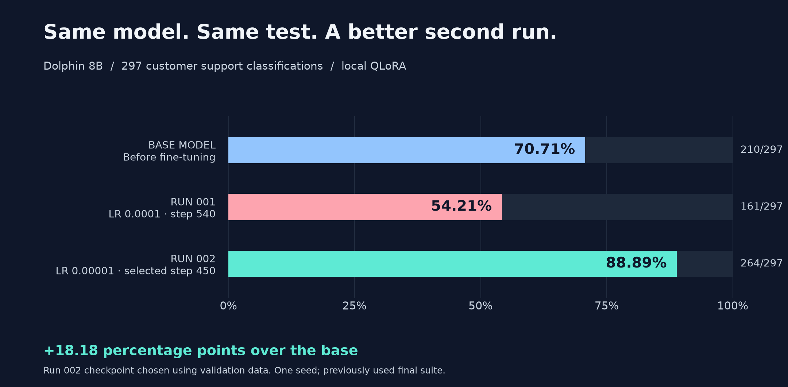

# Results: what improved, and what still fails

**The selected lower-rate adapter answered 264 of 297 classification questions correctly.** The base answered 210 correctly; the first adapter answered 161.

## The comparison

| Model | Correct answers | Accuracy | Three general questions |
| --- | ---: | ---: | --- |
| Base, before fine-tuning | 210/297 | 70.71% | Coherent |
| Run 001: learning rate `0.0001`, step 540 | 161/297 | 54.21% | Repetitive |
| Run 002: learning rate `0.00001`, selected step 450 | **264/297** | **88.89%** | Coherent |

Run 002 corrected **62** answers the base got wrong, but also got **8** previously correct answers wrong. The net gain is **54 correct answers**, or **18.18 percentage points** over the base.

The same 297 classification questions, prompts, and generation settings were used for each evaluation. The three general questions were reviewed separately and do not count toward classification accuracy.

## What counts as correct?

An answer must contain exactly one JSON object with the key `intent`, use an allowed label, and match the expected label.

| Check | What it means | Run 002 |
| --- | --- | ---: |
| Parseable JSON | The answer can be read as JSON | 297/297 |
| Required format and allowed label | One `intent` key, with a label from the allowed list | 295/297 |
| Correct classification | Both the required format and the expected intent | **264/297** |

Valid JSON can still contain the wrong answer. That distinction explains why formatting scores alone are not enough.

## Where does the model still struggle?

The selected adapter got **33 classifications wrong**. These were the most frequent label confusions in this evaluation:

| Expected intent | Returned intent | Cases |
| --- | --- | ---: |
| `set_up_shipping_address` | `change_shipping_address` | 4 |
| `create_account` | `switch_account` | 4 |
| `get_invoice` | `check_invoice` | 3 |

These examples point to remaining label distinctions to review. Each intent has only 11 test questions, so individual intent scores are small-sample observations.

## Validation scores and final scores are different

**Validation** helped choose a saved version of the adapter, called a checkpoint. The same 27 validation questions were checked every 50 updates; step 450 was the earliest checkpoint with the highest monitored score. On the full 270-question validation set, that checkpoint scored **92.96%**, compared with **75.56%** for the base.

**Final evaluation** happened after checkpoint selection and produced the **88.89%** result above. That suite had already been evaluated in run 001. This is one experiment with one seed and public synthetic data; it does not establish accuracy on every new customer message. Three coherent general answers are also a limited check of general ability.

## Which file should be opened?

| To inspect… | Start here |
| --- | --- |
| The experiment in plain language | [Experiment report](../EXPERIMENT.md) |
| Every final prompt, answer, and mismatch | [Run 002 text export](20261028T115822561383Z.txt) |
| Full final results, including settings and token counts | [Run 002 JSON](20261028T115822561383Z.json) |
| Scores, gained/lost cases, and verification records | [Run 002 comparison](training-002-comparison.json) |
| The original model's answers | [Base text export](20261028T002422930075Z.txt) |
| The unsuccessful first adapter's answers | [Run 001 text export](20261028T004036824182Z.txt) |
| Answers at each training checkpoint | [Run 002 validation checks](../experiments/training-002-lr1e5/monitor.json) |

JSON, text exports, and console logs retain their recorded wording, including typos in source prompts and model-generated errors. Timestamps identify files; they are not additional training runs. The `training-002-fit` log records a monitor setup error before any training updates; `training-002-fit-r2` records the successful 27-example diagnostic.
